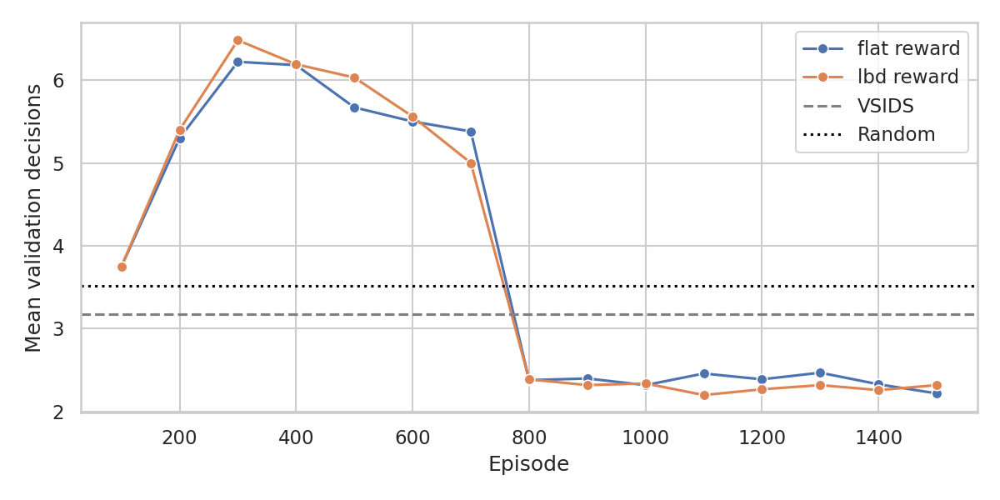
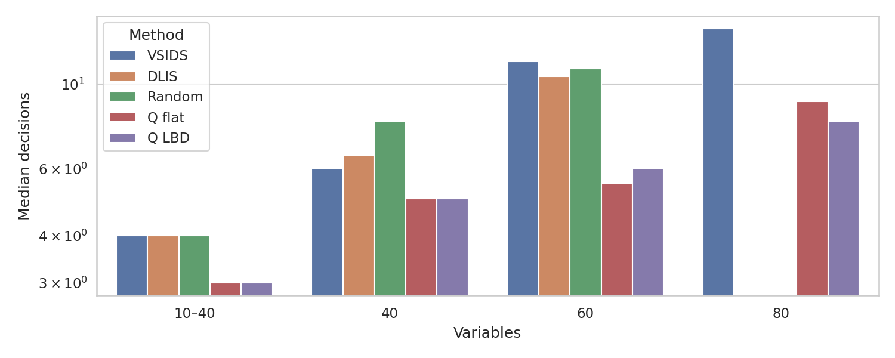
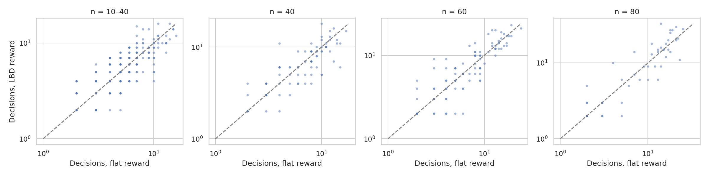
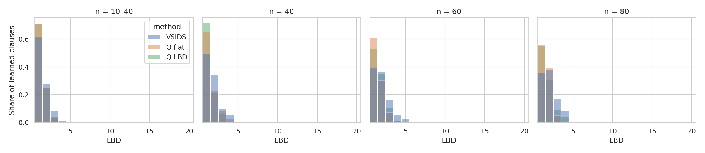
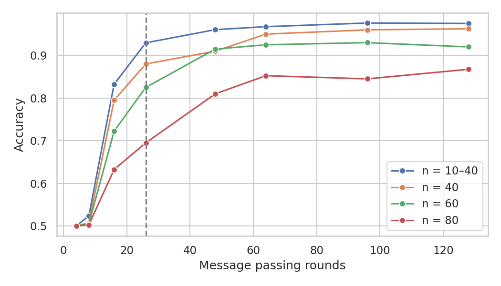

# LBD-Q-SAT

Teaching a SAT solver where to branch with reinforcement learning, and testing whether a reward based on learned clause quality helps.

Deep Learning course project, MSc Artificial Intelligence, University of Bologna.

## What this is

A SAT problem asks whether a set of true/false variables can be assigned so that every clause in a logical formula holds. Modern solvers use an algorithm called CDCL (conflict-driven clause learning). At each step the solver must pick a variable and a value to try next. This is the branching decision, and it is normally made by a hand-written rule such as VSIDS.

This project replaces that rule with a neural network trained by reinforcement learning. It is a from-scratch reimplementation of Graph-Q-SAT (Kurin et al., NeurIPS 2020) with one change to the reward.

- **Graph-Q-SAT (baseline):** the agent gets a small flat penalty for every decision, so it learns to finish in as few decisions as possible.
- **LBD-Q-SAT (this project):** the agent gets the same penalty plus an extra penalty that depends on the quality of the clauses the solver learns after each decision.

Clause quality is measured with the literal block distance (LBD): the number of different decision levels among the literals of a learned clause. Low LBD clauses, especially "glue" clauses with LBD of 2 or less, are known to be the most useful ones for the solver.

The network, the training loop and all hyperparameters are identical for the two rewards, so any difference in the results comes from the reward.

## Summary of findings

- Both agents learn a branching rule that needs fewer decisions than VSIDS, DLIS and random branching, and it carries over to formulas four times larger than the ones seen in training.
- The LBD reward and the flat reward perform the same. No difference between them is statistically detectable.
- The likely reason is that the test formulas are too easy: most learned clauses are already glue clauses, so the LBD term in the reward rarely applies.

## How it works

1. **State.** The current solver state is turned into a graph. Unassigned variables and unsatisfied original clauses are the nodes. An edge joins a variable to each clause it appears in, with a feature saying whether it appears positive or negated.
2. **Network.** A graph neural network runs 4 rounds of message passing (hidden size 64) between variables and clauses, then outputs two Q-values per variable: one for setting it to false and one for setting it to true.
3. **Action.** The agent picks the literal with the highest Q-value (epsilon-greedy during training).
4. **Environment.** The solver applies the decision, runs unit propagation, resolves any conflicts with clause learning and backjumping, and reports the LBD of every clause it learned.
5. **Reward.**
   - Flat: `-0.1` per decision.
   - LBD: `-0.1 - 0.02 * sum(max(LBD - 2, 0))` over the clauses learned in that step. Glue clauses cost nothing extra.
6. **Training.** Deep Q-learning (DQN) with a replay buffer of 20000 transitions, a target network updated every 500 steps, Huber loss, epsilon decaying linearly from 1.0 towards 0.05 over 10000 steps, discount 0.99, learning rate 1e-4, 1500 episodes per reward, at most 300 decisions per episode.

## An important simplification

Graph-Q-SAT controls MiniSat, a fast C++ solver. To keep this project feasible, the agent here controls a small CDCL solver written from scratch in Python (`lbdq/cdcl.py`). It has unit propagation, first-UIP clause learning, backjumping and VSIDS. It has no restarts and no clause deletion.

MiniSat (through PySAT) is only used to generate and label the data.

This means the results are about decision counts on small formulas inside a simple solver. They say nothing about wall-clock speed against a production solver.

## Repository layout

```
notebooks/      the eight notebooks, with outputs, run in order
lbdq/           cdcl.py, qnet.py, neurosat.py (written by the notebooks, copied here for reading)
images/         result plots
models/         trained weights (not tracked in git)
extras/         retired notebooks from an earlier direction, not part of the final project
```

| Notebook | What it does |
| --- | --- |
| `01_data_generation` | Generates SR(n)-style formula pairs (one satisfiable, one not, differing by one literal) and labels them with MiniSat |
| `02_model_and_training` | Warm-up: reimplements and trains NeuroSAT, a supervised satisfiability classifier |
| `03_evaluation` | Warm-up: NeuroSAT accuracy, generalization to larger formulas, decoding assignments |
| `04_cdcl_solver_environment` | The Python CDCL solver, checked against MiniSat labels |
| `05_branching_baselines` | Builds the reinforcement learning datasets and runs VSIDS, DLIS and random branching |
| `06_graph_q_network` | State graph, batching and the Q-network |
| `07_dqn_training` | Trains one agent with the flat reward and one with the LBD reward |
| `08_lbd_q_sat_evaluation` | Compares both agents with the baselines |

Notebooks 02 and 03 are a separate supervised warm-up and only depend on 01.

## How to run

The notebooks are written for Google Colab with Google Drive mounted.

1. Copy the `notebooks/` folder to your Drive.
2. Set `PROJECT_DIR` in the first cell of each notebook to your own Drive folder. Data files are saved there, plots go to its `images/` subfolder and model weights to `models/`.
3. Run the main part in order: `01 -> 04 -> 05 -> 06 -> 07 -> 08`.
4. Optionally run the warm-up: `01 -> 02 -> 03`.

A GPU runtime is recommended for 02 (about 50 epochs) and 07. To run outside Colab, install `requirements.txt` and start the notebooks from the folder where you want the files saved.

## Results

### Setup

- **Training:** 2000 formulas with 10 to 20 variables, 1500 episodes per reward (about 5000 decisions, under two minutes each on a Colab GPU).
- **Evaluation:** 400 test formulas with 10 to 40 variables, 100 formulas each with 40 and 60 variables, and 50 formulas with 80 variables for generalization.
- **Solver check:** the Python solver agrees with MiniSat on all 800 formulas tested, and every satisfying assignment it returns is valid. All 3150 evaluation runs finished with the correct answer.

### The agents learn



Both agents start out worse than random branching, then drop to about 2.3 decisions per validation formula, below VSIDS (3.2) and random (3.5).

### Decisions per formula

Median decisions (lower is better):

| Variables | VSIDS | DLIS | Random | Q flat | Q LBD |
| --- | --- | --- | --- | --- | --- |
| 10–40 | 4.0 | 4.0 | 4.0 | 3.0 | 3.0 |
| 40 | 6.0 | 6.5 | 8.0 | 5.0 | 5.0 |
| 60 | 11.5 | 10.5 | 11.0 | 5.5 | 6.0 |
| 80 | 14.0 | n/a | n/a | 9.0 | 8.0 |



Both agents need between 48% and 83% of the decisions VSIDS needs. The LBD agent uses fewer decisions than VSIDS on 61% of the 10–40 formulas and on 84% of the 80-variable formulas, which are four times larger than anything seen in training.

### Flat reward against LBD reward

| Variables | LBD better | LBD worse | Tie | Wilcoxon p-value |
| --- | --- | --- | --- | --- |
| 10–40 | 23% | 24% | 53% | 0.40 |
| 40 | 34% | 27% | 39% | 0.30 |
| 60 | 34% | 36% | 30% | 0.51 |
| 80 | 34% | 38% | 28% | 0.38 |



The two agents are indistinguishable. Each wins on about as many formulas as it loses, and no difference is statistically significant.

### Learned clause quality

Mean LBD of learned clauses, with the share of glue clauses in brackets:

| Variables | VSIDS | Q flat | Q LBD |
| --- | --- | --- | --- |
| 10–40 | 1.51 (89%) | 1.33 (96%) | 1.34 (96%) |
| 40 | 1.75 (83%) | 1.51 (88%) | 1.35 (94%) |
| 60 | 1.95 (76%) | 1.48 (92%) | 1.60 (89%) |
| 80 | 2.02 (74%) | 1.50 (95%) | 1.64 (86%) |



Both agents learn lower-LBD clauses than VSIDS. The LBD reward does not lower LBD further than the flat reward does: it is better at 40 variables and worse at 60 and 80.

### Why the LBD reward makes no difference here

These formulas are easy for a CDCL solver. A typical one is solved in 4 to 15 decisions with only 2 to 5 conflicts, and 74% to 96% of the learned clauses are glue clauses, which the LBD reward does not penalise. The extra term therefore applies to very few steps, and the two rewards are almost the same reward in practice. A fair test of the idea needs harder formulas, where conflicts are frequent and high-LBD clauses are common.

### Warm-up: NeuroSAT

| Variables | Accuracy, 26 rounds | Best accuracy | Assignments decoded, 26 rounds | Assignments decoded, 128 rounds |
| --- | --- | --- | --- | --- |
| 10–40 | 92.9% | 97.6% | 86.8% | 96.8% |
| 40 | 88.0% | 96.3% | 80.5% | 96.5% |
| 60 | 82.5% | 93.0% | 64.0% | 88.5% |
| 80 | 69.5% | 86.8% | 51.5% | 76.5% |

The model is trained with 26 rounds of message passing on formulas with 10 to 40 variables. Running more rounds at test time raises accuracy, most of all on larger formulas. Training stays at chance level for 23 epochs before accuracy rises sharply.



## Limitations

- The solver is a simple Python CDCL without restarts or clause deletion, not MiniSat.
- The formulas are small and easy, so the LBD reward is rarely active and the comparison between rewards is weak.
- VSIDS has little to work with on formulas with so few conflicts and performs about the same as random branching here. Beating it is a much lower bar than beating VSIDS inside MiniSat.
- Training is short. Exploration (epsilon) had only fallen to 0.53 when training ended.
- Each reward is trained once, with one random seed.
- The agent sees only the original clauses, not the learned ones.
- The LBD reward also penalises the number of non-glue conflicts, not only their quality.
- The comparison counts decisions. In wall-clock time the agents are 4 to 14 times slower than VSIDS.
- The clause-size distribution in the generator has not been checked against the original SR(n) generator and may differ slightly.

## References

- V. Kurin, S. Godil, S. Whiteson, B. Catanzaro. *Can Q-Learning with Graph Networks Learn a Generalizable Branching Heuristic for a SAT Solver?* NeurIPS 2020.
- D. Selsam, M. Lamm, B. Bünz, P. Liang, L. de Moura, D. Dill. *Learning a SAT Solver from Single-Bit Supervision.* ICLR 2019.
- G. Audemard, L. Simon. *Predicting Learnt Clauses Quality in Modern SAT Solvers.* IJCAI 2009.
- V. Mnih et al. *Human-level control through deep reinforcement learning.* Nature, 2015.
